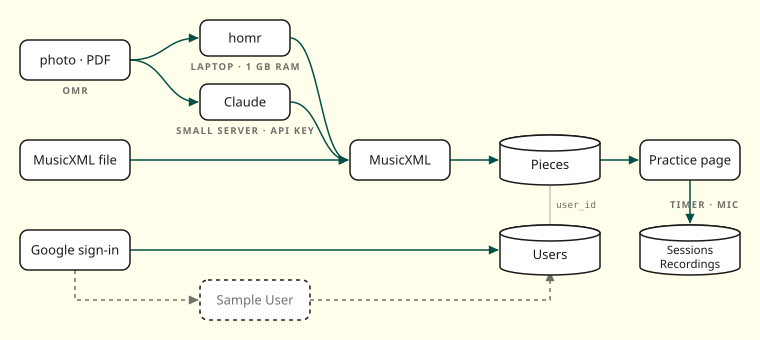

# The Nice Plates 

Flask web app for practicing music. You upload your sheet music, it gets turned into a score you can practice in the browser, and eventually it'll keep track of how much time you put in.

Right now three things work(ish): signing in with Google, uploading a piece to your library, and opening it on the practice page. Home, Progress, and Settings are still mock-ups with fake data for now. There's a full rundown below.

## What works and what doesn't 

| Feature | Where it's at |
|---|---|
| Google sign-in / sign-out | Works if you've set the Google keys, otherwise you're in demo mode |
| Library | Works, shows your pieces |
| Uploading (PDF, PNG/JPG, MusicXML) | Works, up to 20 MB, saves MusicXML + MIDI. Other file types are turned away. Photos need homr (1 GB of memory) or, on a small server, an Anthropic key |
| Practice page (score, cursor, zoom) | Works, shows a Bach *Air* demo if you haven't picked a piece |
| Practice timer + session logging | Start / Pause / Stop and save on the practice page writes a `Sessions` row. Leaving the page pauses it; each timer saves once, and runs over 4 h aren't saved |
| Sheet → MIDI download (`POST /api/midi`) | API only, no UI |
| Recording transcription (`POST /api/transcribe`) | API only, needs an OpenAI key, no UI |
| Home tiles + stats | Your three most recently opened pieces, minutes on each, total time, day streak |
| Progress charts | This week's minutes per day, cumulative time, pieces practiced vs in the library |
| Settings | Shows your account and signs you out; the rest is mock-up |
| Library density toggle | Buttons show up but don't do anything |
| Recordings | Record on the practice page saves a take to `Recordings` and plays it back |
| Sections | Table exists in the database, that's it |

## How it all fits together



It's all one Flask app. The browser only talks to Flask, and Flask handles everything else: SQLite, the sheet music converter, Google sign-in, and OpenAI. There's no background worker, so if a conversion takes a while, the upload page just sits there loading until it's done. Gunicorn runs 4 threads, so other visitors' pages keep loading meanwhile, and only one conversion runs at a time (a second upload waits its turn) so two homr runs can't share the 512 MB box.

- **Front end:** plain Jinja templates, no framework, no build step. Scores are drawn with [OpenSheetMusicDisplay](https://opensheetmusicdisplay.org/) (it's checked in as `opensheetmusicdisplay.min.js`). There's light/dark mode, keyboard support, and reduced-motion handling.
- **Accounts:** Google sign-in through Authlib, with Flask-Login keeping you logged in. No Google keys means everyone just shares one demo account (`Sample User`).
- **Practice state:** your current piece, section, and timer are kept in the session cookie until you stop the timer. That's when it gets saved to the `Sessions` table.
- **Database:** one SQLite file, `niceplates.db`, that gets created in whatever folder you run the app from.

### The sheet music pipeline

Whatever you upload gets picked up at the right step for its file type and comes out the other end as MusicXML + MIDI. The actual note reading (OMR) is done by [homr](https://github.com/liebharc/homr).

| You upload | What happens |
|---|---|
| `.pdf` | each page gets turned into an image at 300 DPI → homr reads each page → pages get merged → MIDI |
| `.png`, `.jpg`, `.jpeg` | homr reads the image → MIDI |
| any of those, with `PHOTO_UPLOADS=off` | Claude reads the image instead of homr (first page of a PDF) → MIDI |
| `.musicxml`, `.xml`, `.mxl` | already good to go → MIDI |

Couple things to know:
- homr only picks up pitch and rhythm, so dynamics and articulations get lost.
- For multi-page PDFs, every page needs the same number of parts or the merge breaks.
- You can run the converter on its own too:
  `python fileConversion/pdfToMidi.py INPUT [-o OUT] [--keep-intermediates]`
- `fileConversion/notes.txt` has our notes comparing oemer, homr, and Audiveris.

## Running it on Render (free tier)

The free box has 512 MB, which is not enough for homr, so photos go to Claude instead. Set these in the Render dashboard (it does not read them from `render.yaml`) and press Manual Deploy after each push.

| Variable | Why |
|---|---|
| `SECRET_KEY` | **Required.** Signs login cookies; the app refuses to start on Render without it. A Blueprint generates it; otherwise make one with `python -c "import secrets; print(secrets.token_hex(32))"` |
| `GOOGLE_CLIENT_ID`, `GOOGLE_CLIENT_SECRET` | Google sign-in; without them everyone is `Sample User` |
| `FORWARDED_ALLOW_IPS=*` | so the sign-in redirect is built as https behind Render's proxy |
| `PHOTO_UPLOADS=off` | photos and PDFs go to Claude instead of homr |
| `ANTHROPIC_API_KEY` | needed for that; `ANTHROPIC_WORKSPACE_ID` too if the key was made outside a workspace |
| `CLAUDE_MODEL` | optional, default `claude-sonnet-5-5` (about 3 cents a page) |

The SQLite file lives on the instance disk, which Render wipes on every deploy, so accounts and uploads do not survive a restart.

## Where stuff lives

| Path | What's in it |
|---|---|
| `app.py` | The Flask app: pages, Google login, practice/timer API |
| `database.py` | SQLite schema, migrations, and queries |
| `ml/api.py` | The `/api` routes for pieces, MIDI conversion, and transcription |
| `ml/text.py` | Pulls tempo, key, and time signature out of transcribed speech |
| `fileConversion/pdfToMidi.py` | The sheet music → MusicXML/MIDI converter (also works as a CLI) |
| `music-app-home/` | Static files (`styles.css`, scripts, images) |
| `render.yaml` | Render deploy config |

## Running it locally

You'll need Python **3.11 or 3.12** (homr won't work on other versions).

```bash
# just the web app
pip install -r requirements.txt

# add this if you want uploads and the ML routes to work
pip install -r ml/requirements.txt

python app.py
```

Then go to http://localhost:8001.

The app still starts up if you skip the ML install. The pages will load, but uploads, `/api/midi`, and `/api/transcribe` will throw a 500 until you install it.

You can also run `ml/api.py` by itself on port 8002 with `python ml/api.py`.

### Tests

```bash
pip install -r requirements.txt -r ml/requirements.txt -r requirements-dev.txt
python -m pytest tests/
```

The tests use a throwaway database in a temp folder and ignore your `.env`. `tests/test_limits.py` marks known bugs as expected failures (`xfail`, with the `ISSUES.md` entry). When you fix one, its test starts failing with `XPASS(strict)`. That's the cue to delete the `@known(...)` marker.

## Config

You don't need any secrets to run it locally. Each one just turns on a feature. Copy `.env.example` to `.env` in the project root and fill in what you need (`.env` is git-ignored, so please don't commit it).

| Variable | What it's for | If you leave it out |
|---|---|---|
| `SECRET_KEY` | Signs the session cookie | Uses `"dev-only"` locally. On Render (where `RENDER` is set) the app refuses to start without it |
| `GOOGLE_CLIENT_ID`, `GOOGLE_CLIENT_SECRET` | Google sign-in | Demo mode, sign-in just drops you on `/home` |
| `OPENAI_API_KEY` | `/api/transcribe` | That route won't work |
| `PORT` | Port on Render | Runs on 8001 locally |

If you're setting up Google sign-in, add `http://localhost:8001/auth/google` (and the Render URL + `/auth/google`) as redirect URIs on the OAuth client.

## Dependencies

There are three requirements files:
- `requirements.txt` is the web app, versions pinned (Flask 3.1.3, Flask-Login 0.6.3, Authlib 1.8.0, python-dotenv, requests).
- `ml/requirements.txt` has flask, openai, python-dotenv, gunicorn, and pulls in everything from `fileConversion/requirements.txt`. Not pinned.
- `fileConversion/requirements.txt` has pymupdf, music21, `homr[cpu]`, and opencv-python-headless. Also not pinned.

## Deploying

`render.yaml` sets up one free Render web service on Python 3.11.9. It installs the app + ML requirements and starts with:

```bash
gunicorn app:app --workers 1 --threads 4 --timeout 300 --bind 0.0.0.0:$PORT
```

Keep it at one worker: a second worker is a second process, which would double homr's memory.

Without Google keys the live site is in demo mode. It needs a `SECRET_KEY` (see above) or it won't start. Also, the database lives on Render's disk, which gets **wiped every time we deploy**.

## API

The piece and ML routes (`ml/api.py`) use the demo account if nobody's signed in. The practice and timer routes (`app.py`) need a real login, and you'll get `401 {"error": "login required"}` without one.

| Method + path | Login? | What it does |
|---|---|---|
| `GET /api/pieces` | demo is fine | Lists your pieces (`id, title, composer, bpm`) |
| `POST /api/pieces` | demo is fine | Takes a `file` (+ optional `title`, `composer`), converts it, saves it, sends you to `/practice?piece=ID` |
| `GET /api/pieces/<id>/musicxml` | demo is fine, has to be your piece | Gives back the MusicXML, or a 404 if it's not yours |
| `POST /api/midi` | no | Converts an uploaded `file` and sends back a `.mid` (doesn't save anything) |
| `POST /api/transcribe` | no | Sends audio to OpenAI Whisper and pulls out tempo/key/time from what's said |
| `GET /api/practice/state` | yes | Current piece, section, and timer |
| `POST /api/practice/piece` | yes | Sets the current piece (`{piece_id}`) |
| `POST /api/practice/section` | yes | Sets the current section (`{section_id}`) |
| `POST /api/timer/start` | yes | Starts the timer (does nothing if it's already going) |
| `POST /api/timer/pause` | yes | Pauses and saves the time so far |
| `POST /api/timer/stop` | yes | Saves the practice session (optional `{notes}`) |

## Database

| Table | What's in it | Does the app use it yet? |
|---|---|---|
| `Users` | Google id, name, email, profile pic | Yes |
| `Pieces` | Title, composer, bpm, and the MusicXML + MIDI files | Yes (uploads) |
| `Sessions` | Practice time (seconds), date, notes | Yes (when the timer stops) |
| `Session_Pieces` | Which pieces you practiced in each session | Yes (when the timer stops) |
| `Sections` | Measure ranges in a piece | Not yet |
| `Recordings` | Audio recordings of a piece | Not yet |

If you change the schema, add it to the `MIGRATIONS` list in `database.py` (it's empty right now). They run in order and get tracked with `PRAGMA user_version`.

## Known issues

**Priority**
- `/api/transcribe` and `/api/midi` don't need a login, so anyone could burn through our OpenAI credits.

**Also Problems**
- Nothing on the front end calls the timer/practice API yet. Plus those routes need a real login while the live site is in demo mode, so practice time never actually gets saved.
- The sidebar always says "Sample User" no matter who's signed in.
- Every page is public, and all guests share the demo account, so if one guest uploads something, every guest sees it.
- If an upload fails, you just get a plain 500 page with no explanation.
- OMR runs during the request, one upload at a time, so a queue of uploads can hit the 300 s timeout (haven't tested this on Render yet).
- The ML and conversion requirements aren't pinned.
- The database on Render gets wiped every deploy.
- Going to `/auth/google` without Google keys, or hitting "deny" on the Google screen, crashes instead of redirecting.
- `niceplates.db` is opened relative to wherever you run the app from, so starting it from a different folder quietly gives you a brand new empty database.
- `ml/README.md` is out of date (it still says Google login isn't done).
