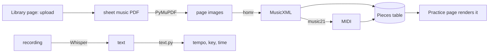

# ml



The top row is Robert's `fileConversion/` pipeline. It can also start from a photo or a MusicXML file.

```bash
pip install -r ml/requirements.txt    # Python 3.11+
cp ml/.env.example ml/.env            # OpenAI key, only /transcribe needs it
python app.py                         # the site on :8001, API included
```

| route | in | out |
|---|---|---|
| `POST /api/pieces` | the library's upload form: sheet, `title`, `composer` | saved to Pieces, then the practice page |
| `GET /api/pieces` | | the library as JSON |
| `GET /api/pieces/ID/musicxml` | | the stored MusicXML, which the practice page renders |
| `POST /api/midi` | sheet | MIDI, nothing saved |
| `POST /api/transcribe` | recording | transcript + tempo / key / time, nothing saved |

Everything belongs to one demo user (`database.demoUser()`) until the Google login branch lands.

Why homr, with test results: the `ml-evals` branch.
