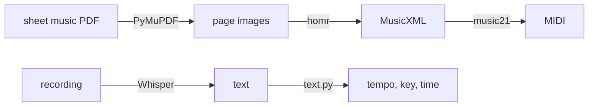

# ml



The top row is Robert's `fileConversion/` pipeline. It can also start from an image or a MusicXML file.

```bash
pip install -r ml/requirements.txt    # Python 3.11+
cp ml/.env.example ml/.env            # OpenAI key, only /transcribe needs it
python ml/api.py                      # API on :8002
curl -F file=@score.pdf localhost:8002/api/midi -o score.mid
curl -F file=@clip.mp3 localhost:8002/api/transcribe
```

To serve it from the main site, add to `app.py`:

```python
from ml.api import api
app.register_blueprint(api)
```

Why homr, with test results: the `ml-evals` branch.
